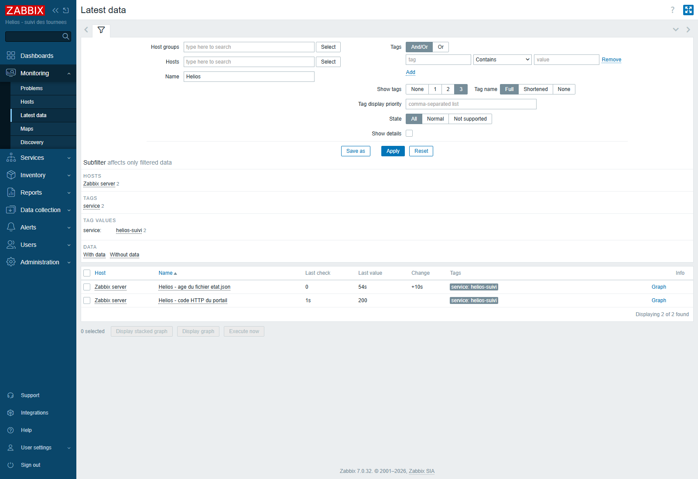
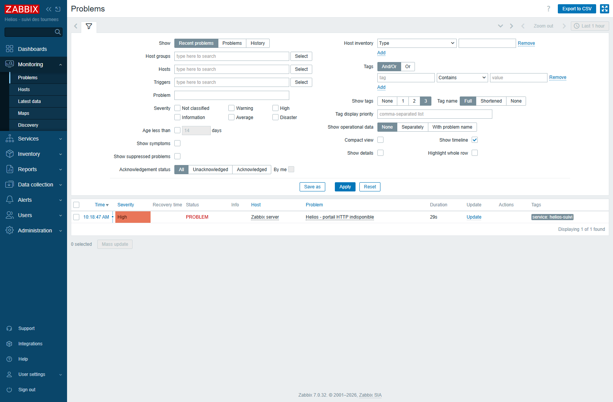
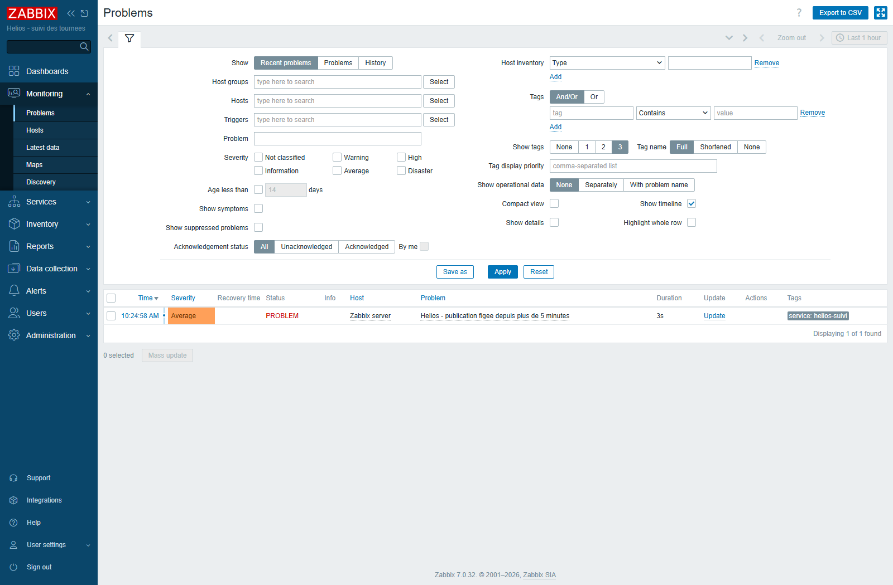
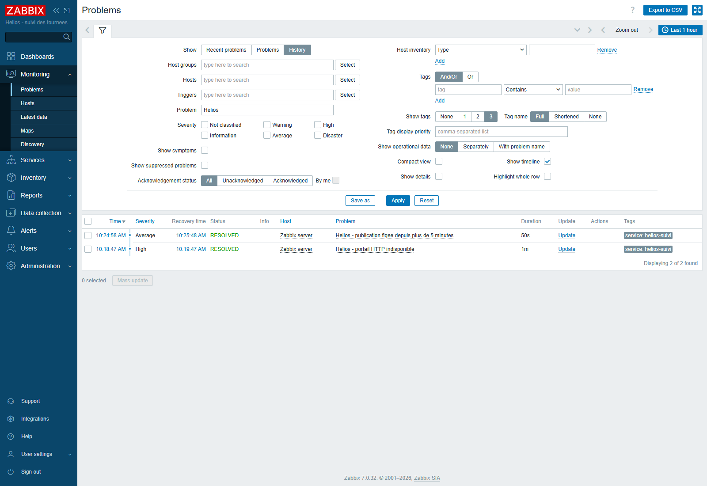

# Bonus E8 — Frontend et alertes Zabbix

Le serveur Zabbix **7.0.32**, MariaDB et le frontend Apache/PHP-FPM sont installés sur srv-core. Le frontend est accessible depuis l'hôte Windows à **http://192.168.56.10/zabbix/**. Les identifiants Admin sont dans le fichier privé `TP-Final-travail/acces-local/ZABBIX-ACCES.txt`, conservé hors du rendu. Le mot de passe initial a été remplacé.

Le frontend écoute sur l'adresse d'administration et sur localhost, port 80 ; le service HTTP de la zone `work` est autorisé en runtime et en permanent. Le port **8080 reste ouvert uniquement dans `internal`**. Le serveur Zabbix écoute sur `127.0.0.1:10051` ; l'agent conserve `Server=127.0.0.1`. SELinux reste Enforcing, avec les booléens officiels `httpd_can_connect_zabbix` et `httpd_can_network_connect_db` activés.

## Éléments et déclencheurs

Sur l'hôte **Zabbix server**, les deux éléments interrogent l'agent local toutes les **10 secondes**.

| Élément | Valeur attendue | Déclencheur | Sévérité |
|---|---|---|---|
| `helios.suivi.http` | 200 | `last(/Zabbix server/helios.suivi.http)<>200` | Haute, priorité 4 |
| `helios.suivi.age` | Moins de 300 s | `last(/Zabbix server/helios.suivi.age)>300` | Moyenne, priorité 3 |

Les deux éléments et les déclencheurs sont activés. L'export Zabbix importable est fourni dans [zabbix-bonus-export.json](configs/zabbix-bonus-export.json). Il ne contient pas les mots de passe de la base ni de l'administrateur.

## Essais réels

1. Arrêt de `helios-suivi.service` : collecte du code HTTP d'échec et apparition de l'alerte **Haute** dans le frontend. Remise en route : retour du code 200 et événement de rétablissement.
2. Publication forcée puis arrêt de `helios-suivi-publish.timer` : attente réelle de plus de cinq minutes, sans changer la date du fichier. L'âge dépasse 300 et le frontend affiche l'alerte **Moyenne**. Publication relancée et timer réactivé : l'âge revient sous le seuil et l'alerte se rétablit.
3. Contrôle final des services, des protections et de l'audit de conformité.

Résultats mesurés : code HTTP **200 → 0 → 200** ; âge du fichier **306 s** lors de l'alerte, puis **2 s** après publication. Les événements serveur sont **26/27** pour le problème HTTP et son rétablissement, **28/29** pour la publication figée et son rétablissement. Les deux éléments restent supportés (`state=0`, aucune erreur). L'audit après ces essais renvoie **Bilan : 9/9**, rc 0.

Preuves : [configuration](preuves/bonus-configuration.txt), [collectes et événements des tests réels](preuves/bonus-alertes-reelles.txt), [état final](preuves/bonus-etat-final.txt).

## Exploitation et limites

Les services `mariadb`, `zabbix-server`, `httpd` et `php-fpm` sont activés au démarrage. Les incidents sont visibles dans **Monitoring → Problems** ; les valeurs sont dans **Monitoring → Latest data** en filtrant sur `Helios`. Les tests ne configurent pas d'envoi de mail ni de notification externe.

Les archives quotidiennes E9 reconstruisent le portail et sa sonde d'agent. L'export ajouté permet de recréer les objets de supervision ; l'historique SQL du serveur Zabbix n'est pas inclus dans ces archives. Pour une exploitation durable, ajouter une sauvegarde cohérente de MariaDB et un accès web chiffré. Les identifiants restent hors du rendu.

Références : [installation officielle et SELinux](https://www.zabbix.com/documentation/7.0/en/manual/installation/install_from_packages), [création d'éléments](https://www.zabbix.com/documentation/7.0/en/manual/api/reference/item/create), [création de déclencheurs](https://www.zabbix.com/documentation/7.0/en/manual/api/reference/trigger/create).
