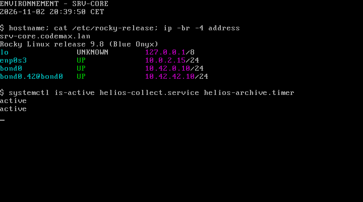
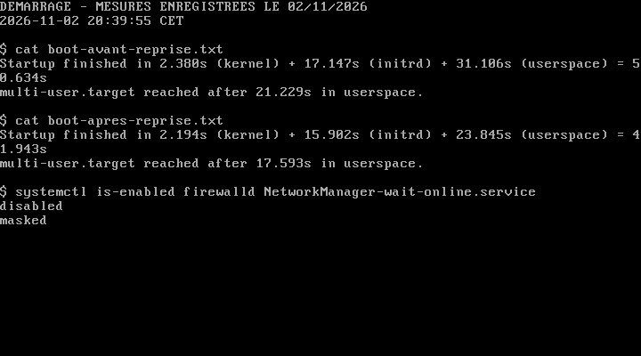
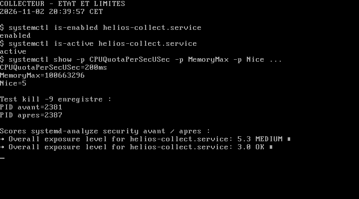
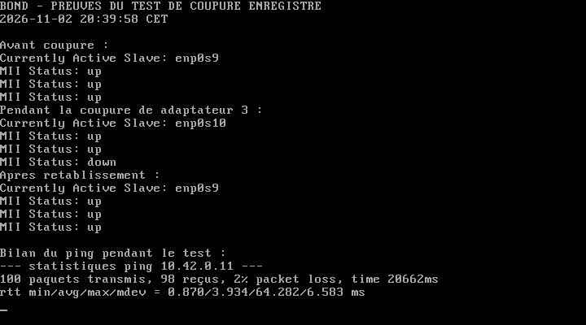
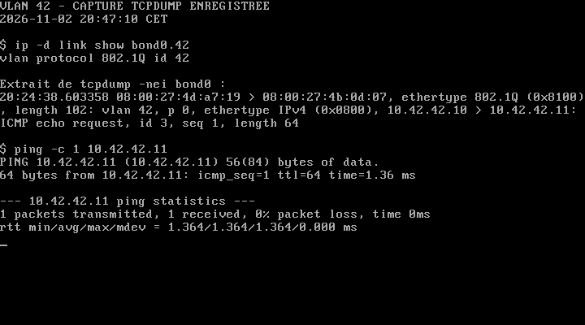
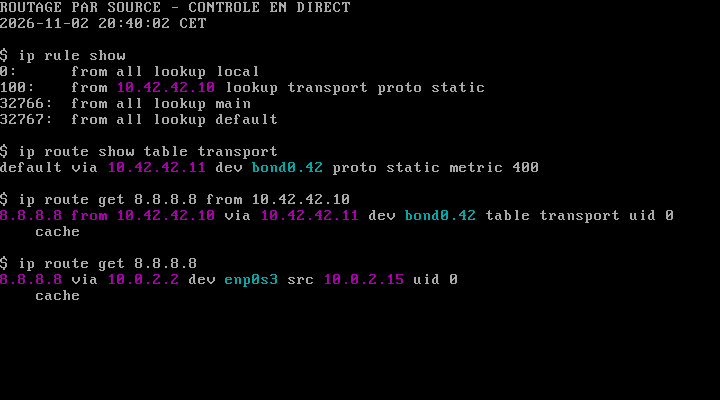
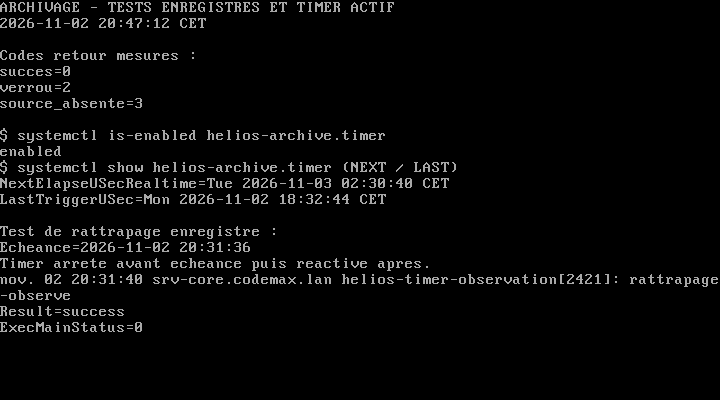
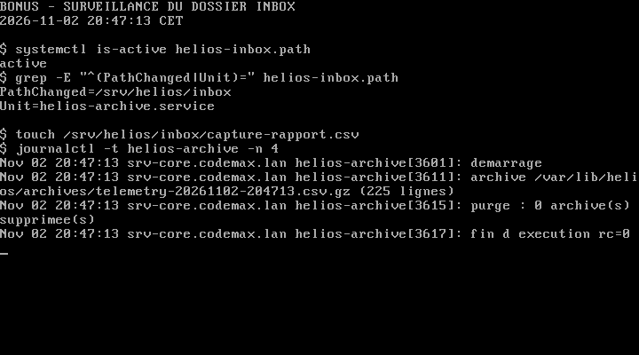
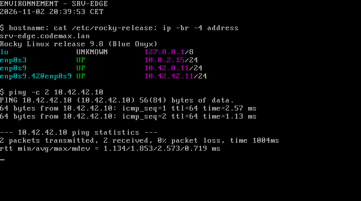

# TP1 — Configuration avancée du système Linux

**Andrea Garcia Magnanon · BTC2 · 2 novembre 2026**

## 1. Présentation du travail

Dans ce TP, j’ai repris le serveur de l’entreprise fictive Hélios Logistique. L’objectif était de rendre la collecte de télémétrie plus fiable, de maintenir la communication en cas de coupure d’un lien et d’automatiser l’archivage des données.

J’ai travaillé avec deux machines Rocky Linux 9.8 dans VirtualBox : **srv-core**, qui héberge les services Hélios, et **srv-edge**, qui me sert à vérifier le réseau. Les commandes d’administration ont été exécutées avec les droits root.

| Réseau | srv-core | srv-edge |
|---|---|---|
| Métier | 10.42.0.10/24 sur bond0 | 10.42.0.11/24 sur enp0s9 |
| Transport — VLAN 42 | 10.42.42.10/24 sur bond0.42 | 10.42.42.11/24 sur enp0s9.42 |
| Administration et Internet | Carte NAT enp0s3 | Carte NAT enp0s3 |

Pour l’administration, j’ai utilisé les redirections SSH de VirtualBox : le port 2221 pour srv-core et le port 2222 pour srv-edge. Cette solution remplace le réseau host-only prévu pour l’accès d’administration, tout en conservant les interfaces métier attendues dans le TP.

Les captures de ce rapport proviennent directement des consoles VirtualBox. Certaines montrent un contrôle en direct, d’autres affichent les résultats enregistrés pendant les tests ; leur titre indique la différence.

---

## 2. Mesurer et alléger le démarrage

J’ai commencé par comparer le démarrage avec et sans les optimisations demandées. Pour avoir une référence exploitable, j’ai réactivé firewalld et l’attente réseau, puis redémarré la VM. J’ai ensuite appliqué les réglages du TP et effectué un deuxième démarrage.

| Mesure | Avant | Après |
|---|---:|---:|
| Noyau | 2,380 s | 2,194 s |
| Initrd | 17,147 s | 15,902 s |
| Espace utilisateur | 31,106 s | 23,845 s |
| **Temps total** | **50,634 s** | **41,943 s** |

Sur ces deux essais, le gain est de **8,691 secondes**, soit environ **17,2 %**. Il s’agit d’une comparaison réalisée avec les services Hélios déjà installés, et non d’une mesure juste après l’installation de Rocky Linux. La charge de l’ordinateur et les caches peuvent aussi faire varier les temps.

J’ai désactivé temporairement **firewalld**, comme demandé dans l’énoncé, qui prévoit sa réactivation au TP3. J’ai également masqué **NetworkManager-wait-online.service** pour supprimer l’attente globale du réseau. Le collecteur lit ici des données locales : il n’a pas besoin d’attendre un serveur distant pour fonctionner.

Dans les résultats de `systemd-analyze blame`, j’ai notamment relevé dracut-initqueue à 13,569 s et kdump à 12,558 s avant modification. Ces durées se chevauchent : on ne peut pas les additionner pour retrouver le temps total. J’ai donc conservé aussi la chaîne critique et les deux graphiques de démarrage, **boot-avant.svg** et **boot-apres.svg**.

---

## 3. Superviser et limiter le collecteur

Le script `helios-collect.sh` enregistre la date, la charge du système et la mémoire disponible dans un fichier CSV. Je l’ai fait fonctionner avec le compte système **helios**, plutôt qu’avec root.

Avec `Restart=on-failure` et `RestartSec=5s`, systemd doit le relancer s’il s’arrête anormalement. Pour le vérifier, j’ai envoyé un **kill -9** au processus principal. Le PID est passé de **2381 à 2387**, et le service est redevenu actif. Cela confirme que la relance ne dépend plus d’une intervention manuelle.

J’ai placé les réglages locaux dans **override.conf**, sans modifier l’unité de base : une collecte toutes les 5 secondes, un quota CPU de 20 %, une limite mémoire de 96 Mio, un poids E/S de 50 et une priorité Nice de 5. La valeur observée, **MemoryMax=100663296**, correspond bien à 96 Mio. Le quota CPU représente 20 % d’un processeur ; le poids E/S règle une priorité relative et ne garantit pas un débit disque.

J’ai ensuite renforcé l’isolation du service dans ce même fichier : masque de création des fichiers à 0077, protection des modules et journaux du noyau, interdiction des priorités temps réel, restrictions sur les espaces de noms et sur les sockets IP. Le collecteur continue de fonctionner avec ces protections. Le score d’exposition donné par systemd passe de **5,3 à 3,0** ; ce score reste un indicateur, pas une garantie de sécurité complète.

Enfin, j’ai rattaché le collecteur à **helios.target** et vérifié sa présence dans les dépendances. Une relation Wants démarre le service avec la cible, mais ne propage pas automatiquement son arrêt. Pour l’exercice sur les processus, j’ai lancé une charge à Nice 19, modifié sa priorité à 5, réglé sa priorité E/S en best-effort 7, puis arrêté le processus. Les sorties correspondantes sont jointes au rendu.

---

## 4. Vérifier la continuité du réseau

Pour éviter qu’une seule carte réseau devienne un point de panne, j’ai regroupé **enp0s9 et enp0s10** dans **bond0**, en mode **active-backup**. Une carte travaille pendant que l’autre reste disponible pour prendre le relais. Le TP utilise ce mode dans VirtualBox ; je n’ai pas mis en place de LACP.

J’ai choisi enp0s9 comme interface principale, avec un contrôle de lien toutes les 100 ms. Ensuite, j’ai lancé un ping continu vers srv-edge et coupé l’adaptateur 3 depuis l’hôte avec `VBoxManage controlvm srv-core setlinkstate3 off`.

Pendant la coupure, **enp0s9 passe down et enp0s10 devient l’interface active**. Après rétablissement du lien, enp0s9 reprend son rôle principal et les deux ports sont à nouveau up.

Le bilan est de **100 paquets envoyés et 98 reçus**, soit **2 requêtes perdues**. Le critère du TP, qui accepte au maximum deux pertes, est donc respecté. Le ping était envoyé toutes les 0,2 seconde.

Ce test m’a permis de vérifier la bascule réelle, au lieu de m’arrêter à la création du bond. Les états complets avant, pendant et après la coupure sont conservés dans les fichiers de preuves.

---

## 5. Isoler le trafic transport et choisir sa route

J’ai créé **bond0.42** sur srv-core et **enp0s9.42** sur srv-edge, avec le VLAN 42. Le ping entre **10.42.42.10 et 10.42.42.11** fonctionne. J’ai également capturé le trafic avec tcpdump : on y lit le marquage **vlan 42**, ce qui confirme que les paquets sont bien étiquetés.

J’ai ensuite créé la table de routage **transport**, numéro 142. Une règle de priorité 100 sélectionne cette table quand l’adresse source est **10.42.42.10**. Le trafic utilise alors **10.42.42.11 comme passerelle sur bond0.42**. Sans cette adresse source, la route par défaut reste sur **enp0s3**, via le NAT.

Les profils NetworkManager conservent ces réglages après redémarrage. Le contrôle `ip route get` prouve le choix de route sur srv-core ; il ne prouve pas, à lui seul, qu’un accès Internet à travers srv-edge fonctionne.

---

## 6. Automatiser l’archivage

J’ai installé le script d’archivage fourni dans les annexes. Il copie la télémétrie, remet le CSV à zéro, compresse la copie et supprime les anciennes archives. Le mode strict, le verrou `flock`, le nettoyage par trap et les messages envoyés à journald rendent son comportement plus facile à suivre.

J’ai testé les trois situations demandées. Pour ne pas fausser le test de source manquante, j’ai arrêté temporairement le collecteur et les déclencheurs, puis tout réactivé une fois le CSV restauré.

| Situation testée | Résultat observé |
|---|---|
| Source disponible, aucun verrou | **0 : succès** |
| Une autre instance détient le verrou | **2 : exécution refusée** |
| Fichier source temporairement absent | **3 : prérequis manquant** |

Le timer planifie l’archivage à **02 h 30**, avec une précision d’une minute, un délai aléatoire maximal de 120 secondes et **Persistent=yes**. L’exécution peut donc être légèrement décalée par rapport à 02:30:00.

Pour vérifier le rattrapage, j’ai utilisé un timer temporaire : je l’ai arrêté avant son échéance, puis relancé après. L’échéance était à **20:31:36** et l’exécution a été enregistrée à **20:31:40**, avec un résultat réussi. Ce test simule l’indisponibilité du timer ; je n’ai pas éteint toute la VM pour cet essai. Le timer temporaire a ensuite été retiré.

Le script des annexes présente une limite : son verrou empêche deux archivages simultanés, mais le collecteur n’utilise pas ce verrou. La copie puis la remise à zéro du CSV ne sont donc pas atomiques face à une écriture concurrente. De même, la purge avec `-mtime +14` raisonne en jours entiers, et non à la seconde près.

---

## 7. Comparer cron et systemd, puis tester le bonus

J’ai conservé les observations de la tâche cron de test et des unités systemd pour comparer leur fonctionnement.

| Point comparé | Ce que j’ai constaté avec cron | Ce que j’ai constaté avec systemd |
|---|---|---|
| Échéance manquée | Je n’ai pas mesuré de rattrapage avec cron. | Le timer de test a rattrapé son échéance après réactivation. |
| Journaux | La commande de test utilise logger pour laisser une trace. | Je retrouve les messages du script et l’historique du service avec journalctl. |
| Dépendances | L’entrée testée décrit une commande et un horaire. | Le timer désigne son service, qui vérifie la présence du CSV. |
| Ressources | Aucune limite propre à l’entrée n’a été ajoutée. | Le service d’archivage applique Nice 10 et une classe E/S idle. |
| Répartition de charge | L’horaire testé est fixe. | Le timer prévoit un décalage aléatoire maximal de 120 s, sans mesure statistique sur plusieurs jours. |
| Prochaine exécution | Elle se déduit de l’expression de planification. | list-timers affiche directement NEXT et LAST. |

Pour ce besoin, j’ai retenu le timer : je peux suivre son état et ses exécutions avec les mêmes outils que les autres services. J’ai retiré les tâches cron temporaires pour éviter de programmer deux fois l’archivage.

Pour le bonus, j’ai activé **helios-inbox.path**, qui surveille les changements dans **/srv/helios/inbox**. Le dépôt d’un fichier déclenche bien un nouvel archivage. L’unité utilise PathChanged pour éviter une relance en boucle tant qu’un fichier reste présent.

Le fichier déposé sert de déclencheur : le service archive toujours la télémétrie, pas le contenu du fichier de test.

---

## 8. Bilan et fichiers remis

À la fin du TP, le collecteur est actif et démarre automatiquement. Son redémarrage après un arrêt forcé fonctionne, ses limites sont appliquées et son isolation a été renforcée. La coupure d’un lien métier provoque bien la bascule sur le second. Les échanges sur le VLAN 42 et les règles de routage restent présents après redémarrage.

L’archivage renvoie les codes attendus, son timer est activé et le déclenchement par dépôt de fichier fonctionne. Le contrôle de srv-edge confirme son adressage et sa communication avec srv-core sur le VLAN transport.

Ce travail m’a surtout permis de relier chaque configuration à un test concret : arrêter le collecteur, couper un lien, retirer temporairement une source ou laisser passer une échéance. Une commande qui se termine sans erreur ne suffit pas toujours à vérifier le résultat attendu.

Le dossier remis contient le **rapport en PDF**, cette version Markdown, les scripts et unités dans **configs/**, ainsi que les captures et sorties de commandes dans **captures/**. Les graphiques SVG permettent aussi de consulter le détail des démarrages.

Les captures ont été prises après les tests, en affichant les résultats enregistrés ou en relançant les contrôles indiqués. Les mots de passe, clés privées et disques des VM ne sont pas inclus. Les deux machines restent démarrées pour permettre une démonstration.
