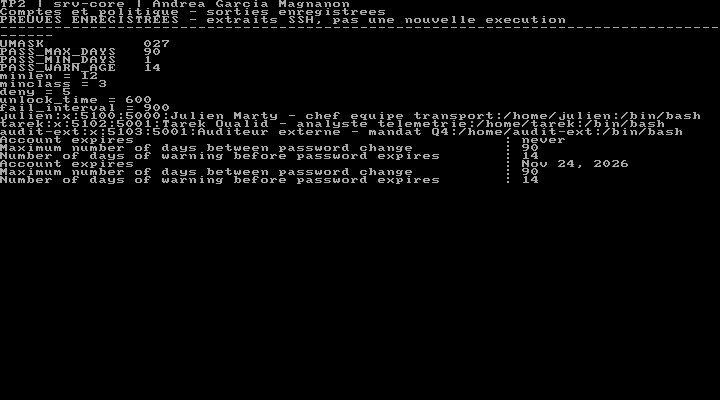
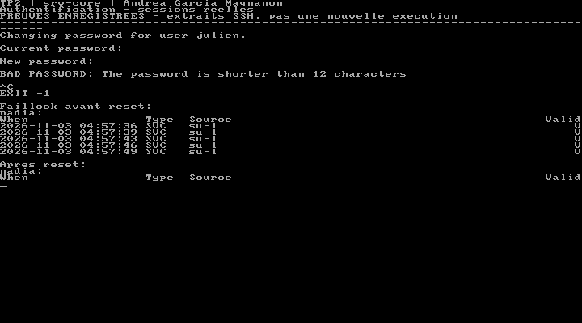
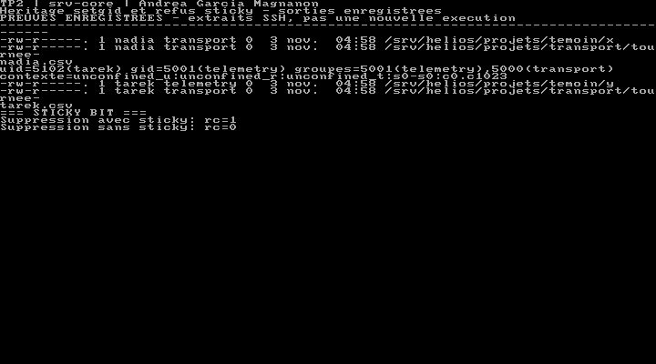
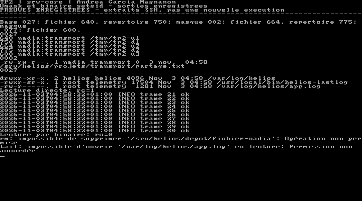
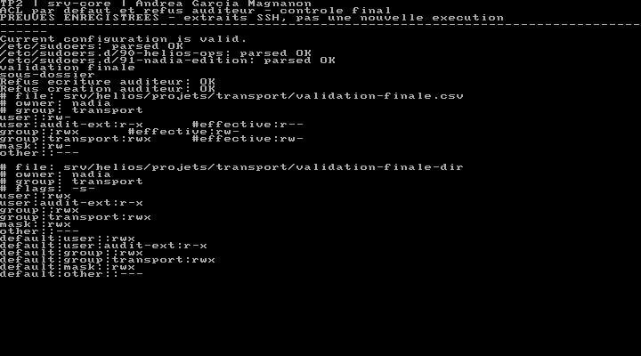
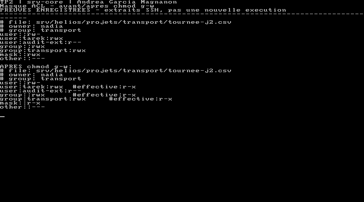
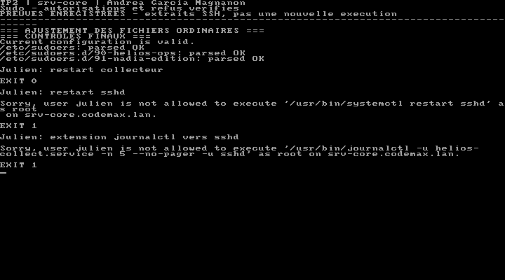
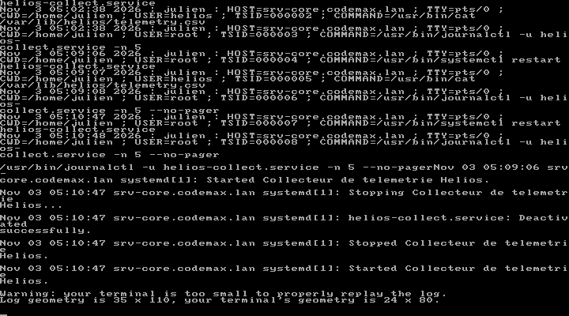
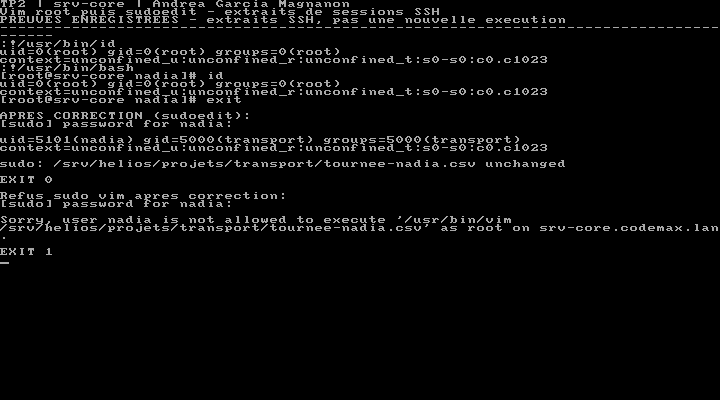

# TP2 — Utilisateurs et permissions sous Linux

**Andrea Garcia Magnanon · BTC2 · TP réalisé le 3 novembre 2026**

## 1. Préparation et création des comptes

Le but du TP était de préparer plusieurs comptes sur le serveur Hélios. Ils ne devaient pas tous avoir les mêmes droits. L’équipe transport devait pouvoir travailler sur ses fichiers, et l’auditeur devait seulement les lire.

Le travail a été fait sur **srv-core**, dans VirtualBox, avec Rocky Linux 9.8. Avant de commencer, le collecteur du TP1 fonctionnait. Une sauvegarde de la VM a été créée avec le snapshot **01-fin-TP1**. Les commandes ont ensuite été lancées par SSH.

J’ai utilisé les comptes suivants :

| Compte | UID | Groupe principal | Autre groupe | Rôle |
|---|---:|---|---|---|
| julien | 5100 | transport | helios-ops | Chef d’équipe |
| nadia | 5101 | transport | — | Exploitante transport |
| tarek | 5102 | telemetry | transport | Analyste télémétrie |
| audit-ext | 5103 | telemetry | — | Auditeur externe |

Les groupes `transport`, `telemetry` et `helios-ops` ont les numéros 5000, 5001 et 5002. Le compte de service `helios` existait déjà au TP1.

Avant de créer les utilisateurs, les valeurs de `login.defs` ont été réglées à **90 jours** pour la durée du mot de passe, **1 jour** minimum entre deux changements et **14 jours** pour l’avertissement. L’umask de départ est **027**. Le fichier `.bashrc` du squelette ajoute aussi l’éditeur vim et un historique de 5 000 commandes avec la date.

Julien a été nommé administrateur du groupe avec `gpasswd -A julien transport`. L’ajout de Nadia au groupe depuis Julien a fonctionné. Pour vérifier les appartenances, j’ai utilisé `id`, car `getent group` n’affiche pas tous les membres qui ont déjà ce groupe comme groupe principal.

Les captures montrent des extraits de résultats SSH enregistrés, puis affichés dans la console VirtualBox. Les sorties complètes sont dans `captures/`.

<!-- pagebreak -->

## 2. Mots de passe et blocage des comptes

Dans `50-helios.conf`, le mot de passe doit faire au moins **12 caractères**, avec **3 types de caractères** et pas plus de **3 caractères identiques à la suite**. Les contrôles du dictionnaire et du nom d’utilisateur sont activés. Avec `enforce_for_root`, la règle s’applique aussi quand root change un mot de passe.

Au départ, aucun profil authselect n’était enregistré sur la VM. Les fichiers PAM ont été sauvegardés, puis le profil `sssd` a été sélectionné avec `with-faillock`. Les comptes utilisés restent des comptes locaux. La commande `authselect check` indique que la configuration est valide.

Le compte se bloque après **5 échecs sur 900 secondes**, pour une durée prévue de **600 secondes**. Six mauvais mots de passe ont été envoyés pour Nadia depuis Tarek. `faillock` montre cinq échecs, puis le compte est bloqué. Après `faillock --user nadia --reset`, le compteur est vide.

Pour le test de qualité, la date du dernier changement de Julien a été reculée d’un jour. Sinon, le délai minimum aurait empêché le test. Avec `passwd`, le mot **helios** a été refusé avec le message `BAD PASSWORD: The password is shorter than 12 characters`. La saisie a ensuite été arrêtée sans changer son mot de passe.

Avec `chage -l`, j’ai vérifié les **90 jours**, l’avertissement de **14 jours** et les **7 jours** d’inactivité après expiration du mot de passe. Le compte de l’auditeur expire le **24 novembre 2026**, soit 21 jours après sa création. Je n’ai pas attendu cette date ni les 600 secondes de déblocage : leurs réglages ont été vérifiés dans la configuration.

<!-- pagebreak -->

## 3. Tests du setgid et du sticky bit

Le dossier `/srv/helios/projets/transport` appartient à Julien et au groupe `transport`. Son mode est **2770**. Le `2` active le setgid : les nouveaux fichiers prennent le groupe du dossier. Un dossier `temoin` a été créé en **0770** pour comparer.

Le test avec Nadia donne le groupe transport dans les deux dossiers, car c’est déjà son groupe principal. Pour voir la différence, il faut utiliser Tarek, dont le groupe principal est telemetry.

| Fichier créé par Tarek | Groupe obtenu |
|---|---|
| `transport/tournee-tarek.csv` | transport |
| `temoin/y` | telemetry |

Le résultat montre que le setgid fonctionne : dans le projet, le fichier de Tarek reçoit bien le groupe transport.

Le dépôt commun `/srv/helios/depot` est en **1777**. Nadia y a créé un fichier, puis Tarek a essayé de le supprimer. Avec le sticky bit, la commande échoue avec **rc=1** et « Opération non permise ».

Pour comparer, le dépôt est passé temporairement en **0777**. Tarek a alors pu supprimer le fichier, avec **rc=0**. Le mode **1777 a été remis après le test**.

Le sticky bit protège donc contre la suppression des fichiers des autres utilisateurs dans ce dossier. Il ne bloque pas leur lecture : cela dépend des permissions de chaque fichier. Le setgid et le sticky bit n’ont pas le même rôle.

À la fin, `ls -ld` affiche `drwxrws---+` pour le projet et `drwxrwxrwt` pour le dépôt. Le signe `+` correspond aux ACL ajoutées dans la suite du TP.

<!-- pagebreak -->

## 4. Umask et programmes setuid/setgid

Avant les tests, j’ai prévu les modes en partant de **666 pour un fichier** et **777 pour un dossier**. L’umask retire des permissions ; il n’ajoute pas le droit d’exécution aux fichiers.

| Umask | Fichier prévu | Fichier obtenu | Dossier prévu | Dossier obtenu |
|---|---|---|---|---|
| 027 | 640 | 640 | 750 | 750 |
| 002 | 664 | 664 | 775 | 775 |
| 077 | 600 | 600 | Non demandé | Non testé |

Les résultats correspondent aux prévisions. Le script `helios-umask.sh` donne ensuite **002 aux membres de transport** et **027 aux autres**. Nadia affiche bien 0002 et l’auditeur 0027.

L’inventaire des fichiers setuid/setgid est dans `inventaire-bits-speciaux.txt`. Parmi les programmes trouvés, `passwd` doit pouvoir modifier les données de mot de passe, `su` permet de changer d’utilisateur après authentification, et `gpasswd` modifie les groupes selon les droits de la personne. Ces trois programmes utilisent le setuid root pour ces opérations protégées.

Un script appartenant à root a aussi été testé avec le mode **4755**. Lancé par Nadia, il affiche toujours **uid=5101(nadia)** : Linux n’applique pas le setuid à ce script. Il a été supprimé après le test.

Le code C `helios-lastlog.c` fourni en annexe a été compilé avec gcc. Le programme est installé en **2755**, avec root comme propriétaire et telemetry comme groupe. Le journal est en **640 root:telemetry**.

Julien ne peut pas lire directement le journal avec `tail` (**rc=1**). Avec `helios-lastlog`, il obtient les dix dernières lignes (**rc=0**). Le programme utilise le groupe telemetry pour lire ce fichier, sans devenir root. Le chemin du programme tail, celui du journal et l’environnement sont fixés dans le code.

<!-- pagebreak -->

## 5. Donner un accès en lecture avec les ACL

La VM utilise **ext4**, alors que le sujet indique XFS. La commande `mount` l’a montré. Les ACL ont quand même fonctionné sur cette installation.

L’auditeur n’est pas membre de transport. Une ACL `u:audit-ext:rX` a été ajoutée aux fichiers et dossiers déjà présents. Le `X` permet de traverser les dossiers et donne l’exécution aux fichiers qui étaient déjà exécutables. L’auditeur peut lire les fichiers du test, mais sa tentative de création est refusée.

J’ai relevé un problème avec le test suivant du sujet : un nouveau fichier créé avec l’umask 002 est en **664**. L’auditeur arrive à le lire grâce au droit de lecture des autres utilisateurs, même sans ACL sur le fichier. Après retrait de ce droit sur le fichier témoin, la lecture échoue bien. Il fallait donc vérifier les ACL, pas seulement le résultat de `cat`.

Les ACL par défaut permettent ensuite aux nouveaux fichiers de recevoir les droits automatiquement. Avec `audit-ext:r--`, le fichier est lisible, mais l’auditeur ne peut pas entrer dans le nouveau sous-dossier `semaine-41` : il manque le droit `x`.

L’entrée par défaut a donc été corrigée en **audit-ext:r-x**, ainsi que les droits du sous-dossier déjà créé. Sur les nouveaux fichiers ordinaires, le masque `rw-` empêche l’exécution effective. Les autres utilisateurs n’ont aucun droit avec `default:other::---`.

Au dernier test, Nadia crée un fichier et un sous-dossier contenant un autre fichier. L’auditeur lit les deux fichiers. En revanche, il ne peut ni ajouter du texte ni créer un fichier dans le sous-dossier. Les fichiers plus anciens ont aussi été corrigés pour retirer les droits de lecture des autres utilisateurs.

<!-- pagebreak -->

## 6. Le masque ACL et les sauvegardes

Sur `tournee-j2.csv`, Tarek a reçu une ACL `rwx`. Au départ, le masque est aussi en `rwx`, donc ces droits sont utilisables.

Après **chmod g-w**, l’entrée de Tarek reste écrite en `rwx`, mais `getfacl` affiche **#effective:r-x**. Le masque est passé en `r-x`. Tarek ne peut plus ajouter de texte : la commande retourne **rc=1**. Après `setfacl -m m::rwx`, l’écriture réussit avec **rc=0**.

Ce que je retiens : sur un fichier avec une ACL étendue, **chmod g-w modifie le masque ACL**. Il limite donc les droits du groupe et des utilisateurs nommés comme Tarek. Il ne supprime pas leurs entrées. Les droits réellement utilisables sont ceux de l’entrée, limités par le masque. Le propriétaire et les autres utilisateurs ne dépendent pas de ce masque.

Les ACL ont été sauvegardées avec `getfacl -R transport`, retirées avec `setfacl -R -b`, puis remises avec `setfacl --restore`. La comparaison avant/après n’affiche aucune différence.

La copie avec **cp -a** conserve les ACL, alors que la copie avec **cp -r** ne les conserve pas dans le test. Une archive a aussi été créée avec **tar --acls --xattrs**. Les copies de test ont ensuite été supprimées.

La sauvegarde finale se trouve dans `configs/acl-transport-2026-11-03.txt`, avec l’archive `transport.tgz`. Pour restaurer la sauvegarde ACL, il faut se placer dans `/srv/helios/projets`, car les chemins enregistrés sont relatifs. Après les essais, le masque des fichiers ordinaires a été remis en `rw-`.

<!-- pagebreak -->

## 7. Autorisations sudo et journaux

Julien fait partie de `helios-ops`. Le fichier `90-helios-ops` lui donne seulement les commandes prévues pour les services Hélios et certaines lectures. Il n’a pas toutes les permissions de root.

La configuration garde l’authentification en mémoire pendant **5 minutes** et autorise **2 essais** de mot de passe. `log_output` enregistre les sorties dans `/var/log/sudo-io`. Les événements sont aussi écrits dans `/var/log/sudo-helios.log`. La vérification avec `visudo -c` est réussie.

| Commande testée | Résultat |
|---|---|
| Julien redémarre le collecteur Hélios | Autorisé, rc=0 |
| Julien redémarre SSH | Refusé, rc=1 |
| Julien lit les 5 dernières lignes du journal Hélios | Autorisé, rc=0 |
| Julien ajoute SSH à la commande de lecture du journal | Refusé, rc=1 |
| Tarek ou l’auditeur redémarre le collecteur avec sudo | Refusé, rc=1 |

Dans la règle fournie, `journalctl` avait un joker `*` après le nom du service. Il a été remplacé par les arguments exacts **-n 5 --no-pager**, pour ne pas pouvoir ajouter d’autres options ou services. Le statut du collecteur est aussi affiché sans pager. La version de départ est gardée dans `90-helios-ops-enonce`.

La liste `DANGEREUX` interdit plusieurs programmes, mais elle ne suffit pas si un autre programme autorisé permet lui-même d’ouvrir un shell. Le test avec vim le montre dans la partie suivante.

Avec `sudoreplay -l user julien`, j’ai retrouvé **000007** pour le redémarrage et **000008** pour la lecture du journal. La session 000008 a été rejouée. Les refus apparaissent aussi dans le journal sudo. Les sorties sont gardées dans `finalisation.txt` et `controle-final.txt`.

<!-- pagebreak -->

## 8. Le problème de sudo vim

Pour le test demandé, une règle temporaire `99-mauvais-exemple` a autorisé Nadia à ouvrir les fichiers du projet avec vim en root, sans mot de passe.

Dans vim, la commande `:!/usr/bin/id` affiche **uid=0(root)**. Avec `:!/usr/bin/bash`, un shell root s’ouvre aussi. Même si la règle limite le fichier que Nadia peut ouvrir, vim peut lancer d’autres commandes avec les mêmes droits.

La règle dangereuse a été supprimée après la démonstration. Elle a été remplacée par `91-nadia-edition`, qui autorise **sudoedit uniquement sur tournee-nadia.csv**. L’exception `!sudoedit_checkdir` est limitée à Nadia, car elle peut écrire dans le dossier du projet.

Avec sudoedit, l’éditeur travaille sur une copie temporaire sous l’identité de Nadia. La commande `id` lancée depuis l’éditeur affiche **uid=5101(nadia)**. Le test se termine sans modifier le fichier. Un nouvel essai avec `sudo vim` est refusé avec **rc=1**.

Ce test montre pourquoi il faut faire attention aux éditeurs autorisés avec sudo. Pour cette démonstration, Nadia est déjà propriétaire du fichier ; l’intérêt est surtout de comparer l’identité utilisée par l’éditeur. L’exception sur le dossier inscriptible reste à limiter au besoin du TP.

Les résultats sont dans `evasion-vim.txt`, `sudoedit-sans-elevation.txt` et `validation-sudo-5.txt`. À la fin, la règle temporaire et le faux script setuid ne sont plus présents.

<!-- pagebreak -->

## 9. Vérifications et bilan

Pour le bonus, les commandes d’audit ont été faites sur **srv-core**. L’audit croisé avec un binôme n’a pas été réalisé. Voici les cinq points relevés, avec la correction ou le contrôle associé.

| Point vérifié | Correction ou contrôle |
|---|---|
| Certains anciens fichiers étaient lisibles par les autres utilisateurs. | Retirer ce droit avec `setfacl -n -m o::--- fichier` et garder `default:other::---`. |
| L’ACL par défaut de l’auditeur ne permettait pas d’entrer dans les sous-dossiers. | Utiliser `setfacl -d -m u:audit-ext:rx /srv/helios/projets/transport` et corriger les dossiers déjà créés. |
| La règle sudo vim permettait d’obtenir root. | Supprimer `99-mauvais-exemple`, utiliser la règle sudoedit et vérifier avec `visudo -c`. |
| Le joker de journalctl laissait trop de choix dans les arguments. | Autoriser exactement `-u helios-collect.service -n 5 --no-pager` et l’équivalent pour archive. |
| Le dépôt commun était le seul élément trouvé ouvert en écriture à tous sous /srv et /home. | Vérifier qu’il reste en `1777` avec `chmod 1777 /srv/helios/depot`. |

L’audit n’a trouvé aucun compte avec un champ de mot de passe vide. L’auditeur a bien sa date d’expiration, et ni lui ni Tarek ne peuvent utiliser sudo. Les mots de passe communs du sujet servent au labo ; sur un vrai serveur, chaque personne devrait avoir le sien.

Les derniers contrôles ont vérifié les comptes, les groupes, les modes, les ACL, les umask et les refus d’accès. Les **huit tests finaux** sur sudo et l’identité de l’éditeur sont réussis. Le collecteur Hélios fonctionne toujours, et le timer d’archivage du TP1 reste activé.

Le rendu comprend les configurations dans `configs/`, les sorties des commandes et neuf captures dans `captures/`, ainsi que ce rapport en Markdown et PDF. Les réglages et les preuves sont conservés pour pouvoir retrouver ce qui a été fait.

Ce TP m’a surtout permis de voir qu’un droit affiché dans une ACL n’est pas toujours un droit utilisable : il faut regarder le masque et tester avec le bon utilisateur. Il montre aussi qu’une règle sudo peut être valide pour Linux tout en donnant trop de permissions.
