# TP3 — Sécurisation de srv-core

**Andrea Garcia Magnanon · BTC2 · 4 novembre 2026**

## 1. Préparation

Dans ce TP, j’ai repris **srv-core** pour régler le pare-feu, sécuriser SSH et surveiller les connexions. Les tests à distance ont été faits depuis **srv-edge**.

Avant les changements, la VM a été sauvegardée dans **03-avant-TP3**. Une console root est restée ouverte dans VirtualBox au cas où SSH ne fonctionnerait plus.

Il manquait la carte d’administration utilisée dans le sujet. Elle a été ajoutée sur les deux VM : srv-core a l’adresse **192.168.56.10**, et srv-edge **192.168.56.11**.

| Interface | Adresse de srv-core | Zone | Rôle |
|---|---|---|---|
| enp0s3 | 10.0.2.15 | drop | Internet par NAT, nouvelles connexions entrantes bloquées |
| enp0s8 | 192.168.56.10 | work | Administration par SSH |
| bond0 | 10.42.0.10 | internal | Réseau métier |
| bond0.42 | 10.42.42.10 | internal | VLAN transport |

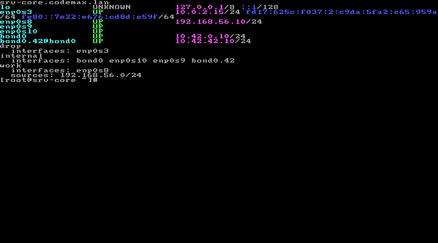

Les zones sont enregistrées dans NetworkManager pour être gardées après un redémarrage. La zone par défaut est **drop**.

Les captures des scans, des sept tests SSH et du blocage relisent les résultats enregistrés. Les autres montrent les contrôles dans la console. Les sorties complètes sont dans `captures/`.

<!-- pagebreak -->

## 2. Pare-feu

J’ai réactivé firewalld et retiré les services inutiles de work et internal. Le port **10051** est autorisé sur le réseau métier, mais refusé sur le réseau d’administration.

Les nouvelles connexions SSH sont limitées à **6 par minute**. Les messages `SSH-NEW` sont limités à **3 par minute**.

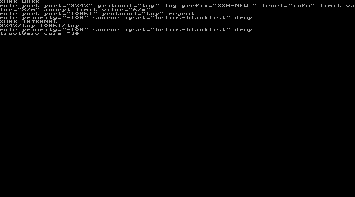

Sur douze essais de connexion au port 22, quatre ont réussi et huit ont échoué. La règle nftables a une réserve de cinq paquets ; le scan et les essais précédents en avaient déjà utilisé une partie. La commande `nft list chain inet firewalld filter_IN_work` permet de retrouver le filtrage installé.

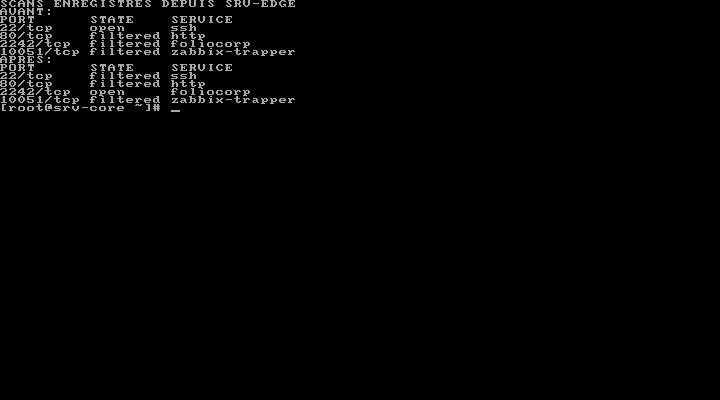

Avant, **22 était ouvert**. Après, **2242 est ouvert** et 22 est filtré. Les ports 80 et 10051 restent filtrés depuis srv-edge sur le réseau d’administration. Le nom « foliocorp » vient de la liste des ports de nmap : ici, c’est bien SSH qui utilise 2242.

Sur le réseau métier, 10051 est autorisé, mais Zabbix n’est pas encore installé. Le refus de connexion à ce port ne suffit donc pas à conclure que le pare-feu le bloque.

<!-- pagebreak -->

## 3. Configuration de SSH

Une clé **Ed25519** a été créée pour sysops sur srv-edge. La clé publique a été copiée sur srv-core, puis la connexion a été testée avant de couper les mots de passe. Le fichier `authorized_keys` est en **600**.

J’ai ajouté sysops et Julien au groupe **ssh-admins**. Seuls les membres de ce groupe peuvent se connecter par SSH. Le fichier `10-helios-hardening.conf` impose la clé publique et interdit root, les mots de passe et la saisie interactive.

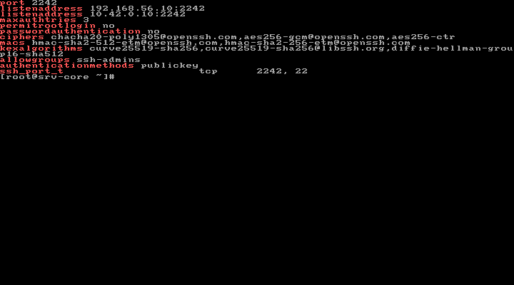

SSH écoute sur **2242**, aux adresses **192.168.56.10** et **10.42.0.10**. Pour changer le port, il a fallu modifier **sshd**, déclarer **2242 dans SELinux avec ssh_port_t**, puis **ouvrir 2242 et retirer 22 dans firewalld**. SELinux est resté en mode Enforcing.

La syntaxe a été vérifiée avec `sshd -t` avant de redémarrer le service. L’ancienne définition SFTP du fichier principal a été commentée, car elle était déjà présente dans le nouveau fichier.

Les tunnels sont refusés par défaut. L’exception helios-ops permet à Julien un accès vers `localhost:10051`. Elle a été vérifiée dans sa configuration calculée par sshd. Sysops ne bénéficie pas de cette exception.

<!-- pagebreak -->

## 4. Tests SSH

J’ai lancé les sept tests depuis srv-edge, en espaçant les connexions pour ne pas être bloqué par la limite du pare-feu.

| Test | Résultat |
|---|---|
| Ancien port 22 | Échec, rc=1 |
| Sysops par clé sur 2242 | Réussite, rc=0 |
| Root | Refus, rc=255 |
| Mot de passe | Refus, rc=255 |
| Nadia, hors ssh-admins | Refus, rc=255 |
| Tunnel de sysops | Canal refusé |
| Ancien échange group14-sha1 | Refus pendant la négociation |

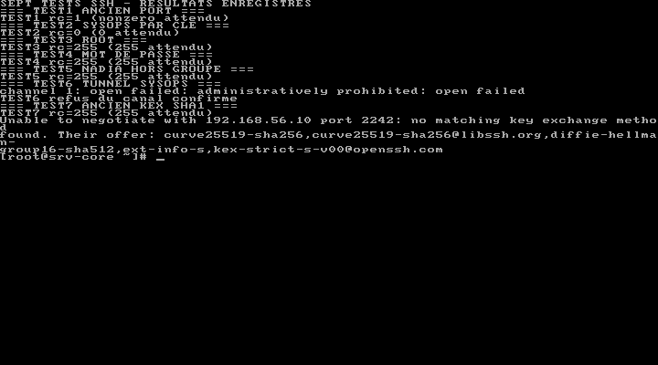

Les journaux confirment le refus des groupes de root et Nadia. Leurs clés de test ont été retirées après les essais.

Pour le tunnel, le port local 9999 s’ouvre, mais le canal affiche **administratively prohibited** quand il est utilisé. Le port local ouvert ne prouve donc pas que le tunnel fonctionne.

La politique crypto est passée à **DEFAULT:NO-SHA1**. Sur Rocky 9, `50-redhat.conf` charge la politique du système. Le fichier **05-helios-crypto.conf** est lu avant lui et fixe les algorithmes du sujet : sshd garde la première valeur lue. `sshd -T` confirme les valeurs appliquées, dont Curve25519 et group16-sha512. Le test avec group14-sha1 échoue bien.

<!-- pagebreak -->

## 5. Journaux

J’ai mis **Storage=persistent** dans le fichier journald `50-helios.conf`. Les limites du sujet ont été reprises : **500 Mo** au maximum, **1 Go** laissé libre, fichiers de **50 Mo**, conservation d’un mois et rotation quotidienne. La compression est activée.

Après `journalctl --flush`, les fichiers sont présents sous `/var/log/journal/`. Avant de redémarrer la VM, un message de test a été enregistré.

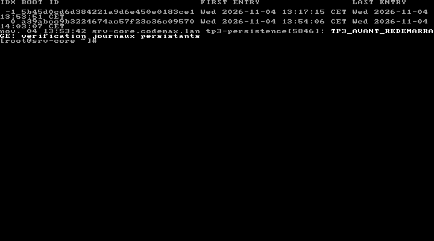

`journalctl --list-boots` affiche deux démarrages. Le message est retrouvé avec `journalctl -b -1 -t tp3-persistence`. Les journaux sont donc bien conservés.

| Recherche | Ce que j’ai trouvé |
|---|---|
| `journalctl -u sshd.service --since '-2h' -p warning` | Aucun message à ce niveau. Les tentatives apparaissent dans les autres recherches. |
| `journalctl _SYSTEMD_UNIT=sshd.service -g 'Invalid user\|Failed\|Accepted'` | Les connexions de sysops et les dix essais du compte pirate. |
| `journalctl --facility=authpriv --since today` | Les messages d’authentification, de session et de SFTP. |
| `journalctl _UID=5101 --since today` | Aucun message pour Nadia dans cette sélection. Son refus est enregistré par SSH avant l’ouverture d’une session à son nom. |
| `journalctl -t sudo --since today -o json-pretty` | Le compte qui utilise sudo et la commande lancée. |

Les recherches complètes sont dans `core-investigation.txt`. `journalctl --verify` a aussi été exécuté ; il vérifie les fichiers du journal, mais ne prouve pas à lui seul leur scellement cryptographique.

<!-- pagebreak -->

## 6. Auditd

J’ai chargé `90-helios.rules` avec `augenrules --load`. Il y a **douze règles** : elles surveillent notamment les comptes, sudoers, SSH, firewalld, le programme setgid du TP2 et les commandes root lancées depuis un compte humain.

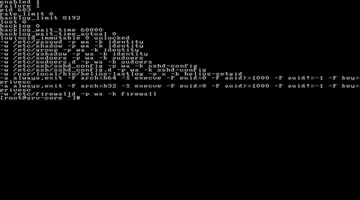

Pour tester, le fichier vide `/etc/sudoers.d/test-audit` a été créé puis supprimé. La recherche avec la clé **sudoers** retrouve les deux actions. Le lancement de `helios-lastlog` par Julien apparaît aussi avec la clé **helios-setgid**.

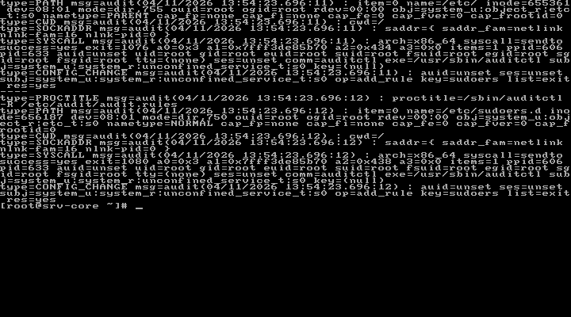

Avec la clé **privesc**, on retrouve **auid=sysops** et **uid=root**. Cela montre que sysops est à l’origine de la commande exécutée en root.

Pour les recherches à distance, j’ai utilisé `-if /var/log/audit/audit.log` afin de lire le fichier plutôt que l’entrée standard de la session. Les rapports aureport sont joints. Leurs totaux comprennent aussi des événements des TP précédents.

Après le redémarrage, les règles sont toujours chargées. Le compteur de perte audit est à zéro dans le contrôle effectué.

<!-- pagebreak -->

## 7. Blocage automatique

Le script **helios-watch-auth.sh** lit les dix dernières minutes du journal SSH. Il compte les connexions en échec par adresse IPv4, sans compter deux fois les messages d’une même connexion.

Si une adresse dépasse **5 échecs**, elle est ajoutée à **helios-blacklist**. Les zones work et internal bloquent ensuite ses nouvelles connexions. **192.168.56.1** est dans la liste blanche du script.

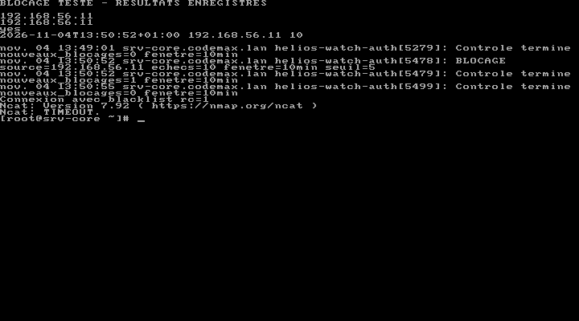

Pour le test, dix connexions ont été tentées depuis srv-edge avec le faux compte **pirate**. Le script a compté **10 échecs pour 192.168.56.11**. Après lancement du service, l’adresse apparaît dans l’ipset. La nouvelle connexion sur 2242 expire avec **rc=1**.

Au deuxième lancement, le résultat est **nouveaux_blocages=0** : aucune deuxième alerte de blocage n’est créée pour la même adresse déjà bloquée.

Le script utilise le mode strict et un verrou flock. Il retourne **0** normalement et **2** si une autre instance tourne déjà. Les deux cas ont été testés. Il écrit ses messages avec le tag `helios-watch-auth`.

Le fichier d’état est dans `/var/lib/helios-watch-auth/blocked.txt`, réservé à root. Ce chemin diffère de l’exemple du sujet. Le script et ses unités sont fournis dans `configs/`.

<!-- pagebreak -->

## 8. Timer et fin des essais

Le timer lance le service toutes les **deux minutes**. Les valeurs sont **OnCalendar=*:0/2**, **Persistent=no** et **AccuracySec=10s**. Les unités ont été vérifiées avec `systemd-analyze verify`.

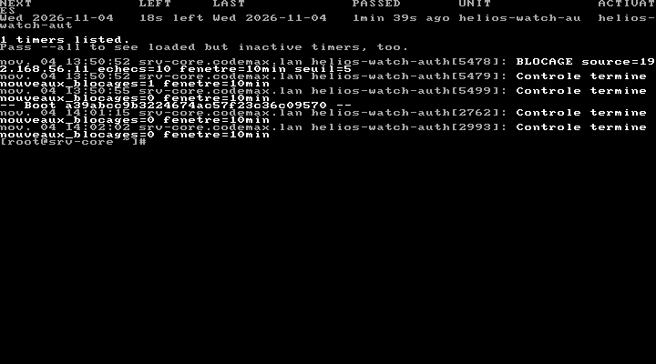

Après les tests, srv-edge a été retirée de la liste noire en mémoire et dans la configuration permanente. Le timer a été arrêté le temps que les échecs sortent de la fenêtre de dix minutes, puis réactivé. Les passages automatiques suivants n’ont pas rebloqué srv-edge.

Un réglage systemd fait aussi attendre la fin du démarrage de NetworkManager avant de lancer SSH sur ses adresses précises. L’accès par clé fonctionne après redémarrage.

Le dernier contrôle depuis srv-edge réussit. Le collecteur Hélios et le timer d’archivage des TP précédents fonctionnent toujours. Les détails sont dans `core-controle-final.txt` et `edge-apres-redemarrage.txt`.

<!-- pagebreak -->

## 9. Bonus

Avec **-e 2**, auditd passe en **enabled 2**. La commande `auditctl -D` échoue avec **rc=255** : les règles ne peuvent plus être supprimées pendant ce démarrage, même par root.

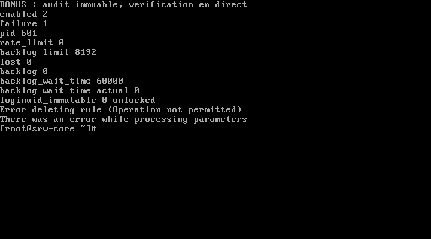

Le fichier a ensuite été remis en **-e 1**, puis la VM a été redémarrée. Le contrôle retrouve **enabled 1** et les règles sont toujours présentes. Les rapports de la semaine et par exécutable sont joints.

`ssh -Q cipher` et `ssh -Q kex` listent les possibilités du client, pas les choix autorisés par le serveur. Pour ces derniers, j’ai utilisé `sshd -T`. La liste du sujet n’active pas tous les échanges que le client connaît, notamment les échanges hybrides.

Enfin, **PasswordAuthentication no** coupe le mot de passe, mais d’autres méthodes peuvent encore être autorisées. **AuthenticationMethods publickey** impose directement la clé publique.

Le rendu contient les configurations, le script demandé, les résultats des commandes et les captures. Le point à retenir pour moi est qu’il faut tester depuis une autre machine : une configuration sans erreur de syntaxe ne suffit pas à vérifier les accès.
